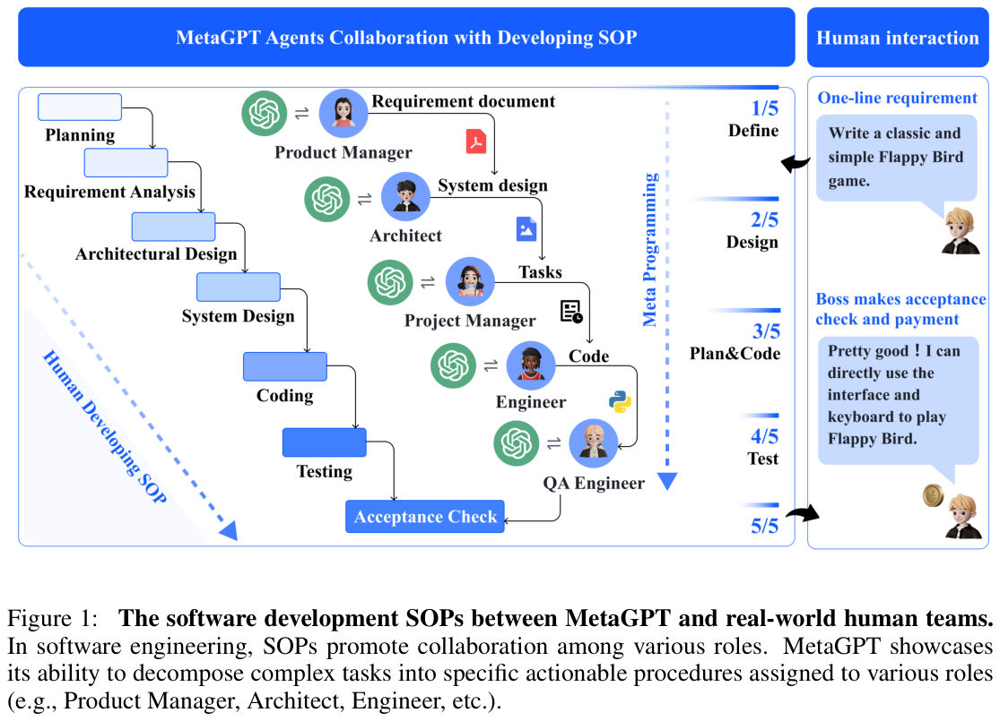

# 综述与论文要点汇总

> 由 7 份综述/精读笔记按标题拼接而成（2026-11-05 合并），原文未改写。

---


## Guo2024-论文要点.md

# Guo 2024 论文要点（大白话版）

> 论文：Large Language Model based Multi-Agents: A Survey of Progress and Challenges
> 发表：arXiv:2402.01680v2，2024 年 4 月
> 这篇是「LLM 多智能体」领域的综述，把整个领域拆开讲清楚。

## 一句话概括
把一个大语言模型拆成好几个「各有分工的小角色」，再让它们互相说话、互相配合，一起完成复杂任务——这就是 LLM 多智能体（LLM-MA）。

## Abstract（摘要）
这篇综述想回答四个问题：
1. 多智能体都在模拟哪些场景？（软件开发、社会、游戏……）
2. 每个智能体的「人设/身份」是怎么定出来的？
3. 它们之间怎么互相交流？
4. 它们的能力是怎么长出来的（怎么变强的）？
另外还整理了常用的测试数据集。

## 1. Introduction（引言）
- 为什么写这篇：多智能体论文涨得太快，之前没人系统地梳理过，所以作者来画一张「领域地图」。
- 全文怎么走：先讲背景（第 2 节）→ 把多智能体拆成四个部分来讲（第 3 节）→ 讲能用在哪些地方（第 4 节）→ 讲工具和数据（第 5 节）→ 讲还没解决的难题（第 6 节）。

## 2. Background（背景知识）
**2.1 单个智能体（只用一个大模型）会什么？**
- 会思考拆解：遇到复杂任务，先拆成小目标，一步步想，还能从过去的经验里学。
- 会用工具：可以调用搜索、计算器、代码解释器这些外部工具。
- 有记忆：短期记忆就是当前对话内容；长期记忆就是把信息存进外部数据库，需要时再取出来。

**2.2 一个智能体 vs 多个智能体，差在哪？**
- 一个智能体：重点是它自己内部怎么想、怎么和环境互动。
- 多个智能体：重点是「大家身份不同 + 互相交流 + 一起做决定」，所以能干更复杂、更接近真实世界的活。

## 3. 把多智能体系统拆开看（全文核心）
作者把任何多智能体系统都拆成四块来理解：

**3.1 智能体和「环境」怎么互动？**
- 沙箱环境：在一个模拟/虚拟世界里活动（比如代码解释器、游戏规则），最常见。
- 物理环境：在真实世界活动，比如机器人扫地、搬东西。
- 没有环境：不跟任何环境打交道，纯粹是几个智能体互相辩论。

**3.2 智能体的身份/人设是怎么来的？**
- 人工设定：程序员直接写好（你是产品经理，你是工程师）。
- 模型生成：让大模型自己想出角色。
- 数据派生：根据已有的数据（比如真实用户记录）生成角色。

**3.3 智能体之间怎么交流？**
- 交流方式（三种气氛）：
  - 合作：朝同一个目标努力。
  - 辩论：各自给观点，互相挑刺，最后得出更好的答案。
  - 竞争：各为自己，甚至目标冲突。
- 交流结构（谁和谁说话）：
  - 分层：一层一层来，像公司上下级。
  - 去中心：大家平级，直接互相说。
  - 中心化：都通过一个「中心角色」传话。
  - 共享消息池：大家把消息发到一个公共池子，按需订阅（MetaGPT 用的就是这个）。
- 交流内容：基本都是文字，具体内容看场景。

**3.4 智能体的能力是怎么变强的？**
- 从哪得到反馈：环境、其他智能体、人类，或者干脆没有反馈。
- 怎么调整自己：
  - 记忆：把经验存起来，下次用。
  - 自我进化：自己改目标、改策略。
  - 动态生成：运行时临时增加或删掉智能体。

## 4. 能用在哪些地方（两大类）
**4.1 解决问题类**（靠分工合作）
- 软件开发：像真实团队一样，产品经理、程序员、测试各司其职。代表：ChatDev、MetaGPT、CAMEL。
- 机器人协作：多个机器人一起规划、导航。代表：RoCo、CoELA。
- 科学实验：多个智能体分工做实验，但**必须有人类把关**（实验贵、模型会瞎编）。代表：材料合成优化。
- 科学辩论：几个智能体互相辩论，提高答案准确率。

**4.2 模拟世界类**（靠角色扮演）
- 社会模拟：模拟一个小社区里人们的行为（从 25 人模拟到上千人）。
- 游戏：狼人杀、阿瓦隆等，测试推理、欺骗、结盟能力。
- 心理学：模拟人的心理实验。
- 经济/金融：模拟交易、市场、宏观决策。
- 推荐系统：把用户和商品都当成智能体来模拟。
- 政策制定：模拟政府应对危机、历史冲突。
- 疾病传播：模拟疫情扩散和民众反应。

## 5. 工具和数据集
- 常用框架：MetaGPT（把人工作流程写进提示里）、CAMEL（两个角色互相扮演）、AutoGen（自然语言+代码都能编排）。
- 常用数据集：软件（HumanEval）、机器人（RoCoBench）、辩论（MMLU、GSM8K）、社会（SOTOPIA）、游戏（AvalonBench）等。
- 一个空白：科学实验和经济模拟还缺统一的标准测试。

## 6. 还没解决的难题
1. 多模态：现在几乎全是纯文字，图像/声音/视频很少。
2. 幻觉传染：一个智能体胡说，其他智能体信了还帮着传，错误被放大。
3. 集体智能没兑现：现在的记忆、自我进化基本是「各调各的」，没有真正利用「大家一起协作」的加成。
4. 规模问题：智能体一多，算力和协调成本爆炸，需要研究「多智能体扩展规律」。
5. 评测不足：各领域各测各的，没有统一标准，结果没法比。
6. 未来方向：往金融、教育、医疗、环境、城市规划拓展。

## 7. Conclusion（结论）
把领域拆成四个维度（环境接口 / 身份 / 交流 / 能力）讲清楚了，再配上应用、数据和难题，给后来人当参考地图。

## 记住这个就够了
- 四个拆解维度：**环境接口、身份设定、交流方式、能力获取**。
- 两大类应用：**解决问题** 和 **模拟世界**。
- 五大难题：**多模态、幻觉传染、集体智能、规模、评测**。

---


## MetaGPT论文精读.md

# MetaGPT 论文精读

## 1. 论文信息

- 题目：MetaGPT: Meta Programming for A Multi-Agent Collaborative Framework
- 作者：Sirui Hong 等
- 会议：ICLR 2024
- arXiv：2308.00352
- 当前公开版本：v7，2024-11-01 修订
- 官方代码：<https://github.com/FoundationAgents/MetaGPT>
- 论文地址：<https://arxiv.org/abs/2308.00352>


*Figure 1｜左：真实人类团队开发 SOP；右：MetaGPT 的对应角色与结构化产物（需求文档 → 系统设计 → 任务 → 代码 → 验收）。来源：MetaGPT, ICLR 2024, p.2*

MetaGPT 研究的是：如何让多个基于大语言模型的 Agent 协作完成复杂的软件开发任务。论文认为，简单地把多个 Agent 串起来聊天，容易出现信息歧义、错误传播和级联幻觉；因此它把真实软件团队中的标准流程、角色分工和中间交付物引入多智能体系统。

## 2. 一句话理解

> MetaGPT 把一个软件公司模拟成一个多智能体系统：产品经理负责需求，架构师负责设计，项目经理负责拆任务，工程师负责实现，测试工程师负责检查。

它的关键不是“Agent 数量多”，而是：

```text
角色分工 + 标准操作流程 SOP + 结构化文档交接 + 可执行反馈
```

## 3. 论文要解决的问题

### 3.1 自由聊天容易失控

传统多 Agent 系统常让 Agent 直接使用自然语言对话。复杂任务中会出现：

- 不同 Agent 对需求理解不一致；
- 一个 Agent 的错误被下一个 Agent 继续放大；
- Agent 重复讨论，产生大量无效消息；
- 任务没有明确的输入、输出和验收标准；
- 最终产物缺少完整的软件结构。

论文把这种问题概括为多个 LLM 串联后的级联幻觉。

### 3.2 人类团队已经有成熟的解决方案

软件公司通常不会让产品经理、架构师和工程师无约束地闲聊，而是通过 PRD、系统设计、接口文档、任务列表和测试报告传递信息。

MetaGPT 的基本想法是：

```text
把人类团队的 SOP 编码到 Prompt、Role、Action 和 Message 中。
```

## 4. 核心思想：Code = SOP(Team)

论文最重要的表达是：

```text
Code = SOP(Team)
```

这里的含义不是让 Agent 直接生成一大段代码，而是先把团队协作流程设计好，再让每个 Agent 执行自己负责的步骤。

对于软件开发任务，MetaGPT 使用类似下面的流水线：

```text
用户需求
   |
   v
Product Manager
生成 PRD、用户故事、需求池
   |
   v
Architect
生成系统设计、数据结构、接口定义、文件列表
   |
   v
Project Manager
拆解开发任务并分配任务
   |
   v
Engineer
根据设计和任务生成代码
   |
   v
QA Engineer
生成测试、运行测试、发现问题
   |
   v
最终软件项目
```

## 5. 系统组成

### 5.1 Role：角色

论文定义了五类典型角色：

1. Product Manager：理解用户需求，形成产品需求文档；
2. Architect：设计系统结构、接口和数据结构；
3. Project Manager：把系统设计拆成开发任务；
4. Engineer：编写具体代码；
5. QA Engineer：测试代码和验证结果。

每个角色具有：

- profile：角色身份；
- goal：目标；
- constraints：约束；
- skills：可使用的技能或工具；
- actions：该角色可以执行的动作；
- memory/context：需要保留的上下文。

因此，MetaGPT 的 Agent 不是只有一个 system prompt，而是“角色 + 动作 + 输入输出规范”的组合。

### 5.2 SOP：标准操作流程

SOP 规定：

- 哪个角色先工作；
- 哪个角色依赖哪个角色的输出；
- 输出必须包含什么字段；
- 下一个 Agent 何时可以启动；
- 出错后如何重新执行。

例如，Architect 不能在没有 PRD 的情况下开始设计，Engineer 不能在没有文件列表和接口定义的情况下开始编码。

### 5.3 Structured Communication：结构化通信

MetaGPT 不鼓励 Agent 之间只发送自由文本，而是要求交付结构化产物：

- PRD；
- 用户故事；
- 需求池；
- 系统设计；
- API 接口；
- 数据结构；
- 文件列表；
- 任务列表；
- 代码文件；
- 测试报告。

这相当于给每个 Agent 之间增加了一个“接口协议”。

重要理解：

> Agent 之间传递的不是思维过程，而是可以被下游使用的中间产品。

### 5.4 Publish-Subscribe：发布订阅

MetaGPT 使用共享消息池：

```text
Agent 产生结构化消息
        |
        v
发布到共享消息池
        |
        v
其他 Agent 根据自己的订阅关系获取需要的消息
```

这样做有两个好处：

1. 不需要让每个 Agent 和所有其他 Agent 建立单独连接；
2. Agent 可以根据角色只读取相关信息，降低信息过载。

例如：

- Architect 主要订阅 PRD；
- Project Manager 订阅系统设计；
- Engineer 订阅任务列表、系统设计和接口；
- QA Engineer 订阅需求、设计和代码。

### 5.5 Executable Feedback：可执行反馈

MetaGPT 不仅让 QA 或 Engineer 阅读代码并发表评论，还要求执行代码和测试。

流程大致是：

```text
生成代码
   -> 运行代码/单元测试
   -> 读取错误信息
   -> 根据历史上下文和原始需求修改代码
   -> 再次执行
```

论文中最多允许重试三次。这个机制很重要，因为“代码看起来合理”不等于“代码可以运行”。

## 6. 论文的实验设计

论文使用了三个层次的评测：

### 6.1 HumanEval

HumanEval 包含 164 个手写 Python 编程任务，主要测试函数级代码生成能力。

### 6.2 MBPP

MBPP 包含 427 个 Python 编程任务，覆盖常见编程概念和标准库使用。

### 6.3 SoftwareDev

作者构造了一个更接近真实软件开发的任务集，共 70 个任务，包含小游戏、图像处理和数据可视化等类型。主比较中选取了 7 个代表性任务。

SoftwareDev 不只看代码能不能通过单元测试，还评价：

- 可执行性；
- 运行时间；
- Token 使用量；
- 生成文件数量；
- 代码行数；
- 每行代码所需 Token；
- 人工修复次数。

## 7. 实验结果

### 7.1 HumanEval 与 MBPP

论文报告 MetaGPT 在 HumanEval 和 MBPP 上的 Pass@1 分别达到：

```text
HumanEval：85.9%
MBPP：87.7%
```

这些数字说明，多 Agent 流程可以帮助基础模型生成更可靠的函数级代码；但需要注意，这不是一个完全独立的新模型，而是 Agent 流程与后端 LLM 的组合结果。

### 7.2 SoftwareDev

论文给出的主要结果如下：

| 指标 | ChatDev | MetaGPT（无可执行反馈） | MetaGPT |
|---|---:|---:|---:|
| 可执行性 | 2.25 | 3.67 | 3.75 |
| 运行时间（秒） | 762 | 503 | 541 |
| Token 使用量 | 19,292 | 24,613 | 31,255 |
| 代码文件数 | 1.9 | 4.6 | 5.1 |
| 总代码行数 | 77.5 | 194.6 | 251.4 |
| 每行代码 Token 数 | 248.9 | 126.5 | 124.3 |
| 人工修复次数 | 2.5 | 2.25 | 0.83 |

这里有一个容易忽略的结论：

> MetaGPT 使用的总 Token 更多，但生成的代码更多、结构更完整、单位代码成本更低、人工修复更少。

所以它优化的不是单轮回复成本，而是复杂软件任务的整体产出质量。

### 7.3 角色消融实验

论文逐步加入 Product Manager、Architect 和 Project Manager，观察角色数量变化：

| 角色配置 | Agent 数量 | 代码行数 | 人工修复 | 可执行性 |
|---|---:|---:|---:|---:|
| 只有 Engineer | 1 | 83 | 10 | 1.0 |
| Engineer + Product Manager | 2 | 112 | 6.5 | 2.0 |
| Engineer + Product Manager + Architect | 3 | 143 | 4.0 | 2.5 |
| Engineer + Product Manager + Project Manager | 3 | 205 | 3.5 | 2.0 |
| 四角色组合 | 4 | 191 | 2.5 | 4.0 |

结论是：合理的角色分工确实能提升结果质量，但会增加成本。多 Agent 的价值不是简单增加 Agent 数量，而是加入能够减少下游歧义的角色。

### 7.4 可执行反馈消融实验

加入可执行反馈后：

- HumanEval Pass@1 提升 4.2 个百分点；
- MBPP Pass@1 提升 5.4 个百分点；
- SoftwareDev 可执行性从 3.67 提升到 3.75；
- 人工修复次数从 2.25 降低到 0.83。

这说明执行测试比单纯让另一个 Agent“看一眼代码并评论”更有效。

## 8. 论文真正的贡献

我认为论文最重要的贡献有四点。

### 8.1 把多 Agent 从“聊天”变成“流程”

MetaGPT 把多智能体系统从开放式对话转成了有顺序、有依赖、有验收标准的工作流。

### 8.2 把自然语言通信升级为中间产物通信

PRD、系统设计、接口和测试报告本质上都是协议化的中间表示。它们让 Agent 的协作更容易检查、复用和调试。

### 8.3 把软件工程中的验证机制引入 Agent

编译、运行、单元测试和错误修复，形成了一个真实的执行反馈回路。

### 8.4 提供了可迁移的系统模板

虽然论文应用是软件开发，但架构可以抽象成：

```text
需求理解 Agent
    -> 规划 Agent
    -> 专业执行 Agent
    -> 结果验证 Agent
    -> 输出 Agent
```

这就是它对你后续遥感研究最有价值的地方。

## 9. 对论文的批判性分析

### 9.1 优点

- 角色职责明确；
- 中间结果结构化；
- 工作流容易解释；
- 有消融实验；
- 有运行反馈；
- 代码开源，方便复现；
- 比自由对话式 Agent 更适合复杂任务。

### 9.2 局限

#### 任务域比较窄

MetaGPT 的主要验证集中在软件开发。它不能直接证明同样的结构在遥感、医学或科学发现任务上同样有效。

#### 依赖后端大模型

论文中 GPT-4 后端明显优于 GPT-3.5 和 DeepSeek Coder 33B。也就是说，MetaGPT 的效果不仅来自框架本身，也受到基础模型能力影响。

#### 成本较高

多个角色需要多次调用 LLM，还需要执行和重试。虽然每行代码的 Token 产出较好，但总 Token 使用量高于 ChatDev。

#### SOP 偏静态

论文中的流程主要是预定义的。它擅长软件公司的线性开发过程，但对需要动态改变策略、并发执行和临时增加专家的任务支持有限。

#### 结果验证仍依赖测试覆盖率

代码通过测试并不等于软件完全正确。对于遥感任务，模型输出还需要地理坐标、物理意义、时间一致性和不确定性检查，这些不能直接用普通单元测试代替。

#### 可复现实验存在版本问题

论文最初提交于 2023 年，当前 arXiv 页面显示的是 2024-11-01 的 v7 版本。不同版本、不同后端模型和不同提示词可能导致结果不一致，复现时应记录：

- 论文版本；
- MetaGPT Git commit；
- Python 版本；
- 后端模型；
- temperature；
- API 版本；
- 完整输入提示；
- Token 和费用。

## 10. 对你后续遥感方向的启发

不要把 MetaGPT 直接照搬成“产品经理、架构师、工程师”五个角色。更合理的迁移方式是保留它的系统思想，重新定义遥感 SOP。

例如：

```text
用户任务
   |
   v
Task Understanding Agent
把自然语言需求转换为目标、区域、时间和传感器条件
   |
   v
Data Planning Agent
选择数据源、时间范围、分辨率和预处理方案
   |
   v
Analysis Agent
调用分类、检测、分割或变化检测模型
   |
   v
Verification Agent
检查坐标系、置信度、时间一致性和结果异常
   |
   v
Report Agent
输出结构化结论、图层和证据
```

对应的中间产物可以是：

- `TaskSpec`：任务说明；
- `DataSpec`：数据需求；
- `PreprocessPlan`：预处理计划；
- `AnalysisResult`：模型结果；
- `VerificationReport`：验证报告；
- `FinalReport`：最终输出。

这比让多个 Agent 自由讨论“这张图里有什么”更适合科研和工程实现。

## 11. 最适合你的复现实验

建议不要一开始运行完整的软件公司，而是先做一个最小 MetaGPT 风格系统：

```text
Planner Agent -> Researcher Agent -> Reviewer Agent
```

任务：

```text
调研一个指定主题，并输出带来源的研究报告。
```

三个 Agent 的职责：

- Planner：拆解研究问题和检索任务；
- Researcher：分别收集和整理材料；
- Reviewer：合并、去重、检查逻辑和来源。

然后再把任务替换成：

```text
调研某个遥感目标检测数据集，并给出实验方案。
```

这样你可以直接验证 MetaGPT 的三个核心机制：

1. 角色分工；
2. 结构化消息；
3. Reviewer 的结果验证。

## 12. 最终判断

MetaGPT 值得复现，但应该把它理解为：

> 一个“基于 SOP 和结构化交付物的多智能体工作流框架”，而不是一个新的遥感模型或一个单独的基础模型。

它最适合作为你研究多智能体的第一篇论文和第一个复现项目。真正值得迁移到遥感方向的不是软件公司这个表面设定，而是下面这条原则：

```text
先定义任务流程和中间产物，
再定义 Agent 角色，
最后让模型填充每个步骤。
```

## 13. 参考资料

1. Hong et al. *MetaGPT: Meta Programming for A Multi-Agent Collaborative Framework*. ICLR 2024. <https://arxiv.org/abs/2308.00352>
2. MetaGPT 官方代码仓库：<https://github.com/FoundationAgents/MetaGPT>
3. MetaGPT 官方文档：<https://docs.deepwisdom.ai/>

---


## Tran2025-协作机制综述-总结.md

# Tran et al. 2025 精读总结：Multi-Agent Collaboration Mechanisms — A Survey of LLMs

> **原文**：Khanh-Tung Tran, Dung Dao, Minh-Duong Nguyen, Quoc-Viet Pham, Barry O'Sullivan, Hoang D. Nguyen. *Multi-Agent Collaboration Mechanisms: A Survey of LLMs*. arXiv:2501.06322（2025-01）。
> **本地文件**：`papers/Tran 等 - 2025 - Multi-Agent Collaboration Mechanisms A Survey of LLMs.pdf`
> **一句话定位**：不讲单个 agent 能力，也不按应用分，而是**只讲"协作机制"本身**——用五维框架（actors / types / structures / strategies / coordination）把 LLM 多智能体系统的"怎么一起干活"讲透。

---

## 1. 它要解决什么问题

现有综述多按**应用领域**或**系统架构**来分类 LLM-MAS，忽略了"通信/协作"在协调 agent 行为中的核心作用。本文的出发点：

- 协作不只是"交换信息"，还包含**协调与管理**（coordination & orchestration）；后者才是多智能体能力的来源。
- LLM 本来不是为相互通信设计的，因此"怎么让多个 LLM 有效协作"是一个独立且未讲透的问题。
- 本文聚焦协作的 **know-how**：协作类型、策略、通信结构、协调架构。

**与其它综述的差异**：Li 2024 讲 workflow 五模块（含协作，但只是其中一块）；Guo 2024 讲系统全貌；本文**只聚焦协作这一层**，因此分类最细、可直接当"协作设计手册"用。

---

## 2. 核心概念与形式化（§3）

**单个 agent** 表示为五元组：

```
a = { m, o, e, x, y }
```
- `m = {arch, mem, adp}`：模型（架构 + agent 专属记忆 + 可选适配器）；对 LLM agent，arch 是语言模型，mem 通常是 system prompt `r`。
- `o`：目标；`e`：环境/上下文；`x`：输入感知；`y`：输出/动作，`y = m(o, e, x)`。

**多智能体协作系统** `S`：

```
S: A = {a_i}（agent 集合，n 可预定义或动态调整）, O_collab（共享目标集合）, E（共享环境）, C = {c_j}（协作通道集合）
y_collab = S(O_collab, E, x_collab | A, C)
```

**协作通道 `c`（本文的核心概念）**：agent 之间协同的机制，由四个属性定义——**actors（参与者）、type（类型）、structure（结构）、strategy（策略）**；任一属性不同即为不同通道。这就是全篇五维框架的来源。

**协作发生的三个层次**：早期（共享数据/上下文/环境）、中期（共享参数/权重，如联邦学习）、晚期（集成输出/动作，如投票）。

---

## 3. 分类体系：协作五维（全文骨架）

```
协作通道 C
├── Actors：参与的 agent
├── Types：Cooperation / Competition / Coopetition（+ 混合协调）
├── Structures：Centralized / Decentralized & Distributed / Hierarchical
├── Strategies：Rule-based / Role-based / Model-based
└── Coordination / Orchestration Layer：Static / Dynamic
```
（另见 §1 图 2 总框架图）

### 3.1 协作类型 Types（§4.2）

| 类型 | 定义 | 优点 | 缺点 | 代表场景 |
|---|---|---|---|---|
| **Cooperation** | agent 对齐目标、共同完成共享目标 | 按专长分工；设计简单 | 目标不一致会低效；单点失败会被放大 | 代码生成（ChatDev、MetaGPT）、决策、游戏 |
| **Competition** | agent 优先自身目标，目标可能冲突 | 促使 agent 表现更好；促进适应性策略 | 需要冲突解决机制；竞争未必有益 | 辩论、游戏、问答 |
| **Coopetition** | 部分任务合作、部分竞争 | 在权衡中达成互惠协议 | 研究尚少、探讨不深 | 谈判、MoE（专家竞争 + 门控选择） |
| **Hybrid** | 同一系统中不同通道类型共存并协调 | 组合各类型优势，动态更丰富 | 协调复杂度高，需角色分配与协议支撑 | LEGO（先合作再竞争）、辩论 + 裁判 |

关键点：一个系统里可以同时存在多个协作通道，`c_comp`（辩论双方）与 `c_coop`（裁判与辩手）可以并存。若协作通道设计不佳，多智能体甚至会被"强提示词的单智能体"打败（文中引用 [128]）。

代表工作：CAMEL（角色扮演对话）、AutoGen（可定义对话模式）、MetaGPT（SOP 流水线）、AgentVerse（招募/决策/评估分工）、LLMARENA（竞争基准）、LEGO（解释者 vs 批评者）。

### 3.2 协作策略 Strategies（§4.3）

| 策略 | 定义 | 优点 | 缺点 | 代表 |
|---|---|---|---|---|
| **Rule-based** | 交互被预定义规则严格控制 | 高效、可预测、公平一致 | 适应性差、难扩展到复杂任务 | 辩论 + 多数投票、共识寻求、同行评审式互评 |
| **Role-based** | 预定义角色/分工，各司其职 | 模块化、可复用、用好各自专长 | 结构僵化；依赖 agent 间连接质量 | MetaGPT（SOP 编码进 prompt）、AgentVerse、RoCo、BabyAGI |
| **Model-based** | 基于输入/环境/目标做概率化决策 | 适应动态环境、抗不确定性 | 实现复杂、算力开销大 | 心智理论（ToM）推理、概率图模型（PGM）、概率时间自动机 |

选型建议（文中）：流程严格 → rule-based；任务专门化、有结构 → role-based；环境不确定、需适应 → model-based。

### 3.3 通信结构 Structures（§4.4）

| 结构 | 定义 | 优点 | 缺点 |
|---|---|---|---|
| **Centralized（星型）** | 所有 agent 连到一个中心 agent | 设计实现简单；资源分配高效 | 中心节点故障会导致整体崩溃 |
| **Decentralized / Distributed** | 决策分散在多个 agent | 部分失败仍可运行；可扩展；更自主 | 资源分配低效；通信开销高 |
| **Hierarchical（层级）** | 分层，有不同角色与权限 | 通信瓶颈低；任务分层卸载 | 边缘设备成关键点；复杂度与延迟高 |

代表：DyLAN（多层前馈网络，含 agent 选择与早停）、AgentVerse、社会行为自发涌现。

### 3.4 协调与编排 Coordination & Orchestration（§4.5）

- **Static（静态）**：靠领域知识与预定义规则建立通道。常见"顺序串联"通道（前一个输出拼进下一个输入）；例子：MapCoder（程序合成四阶段）、MACRec（推荐：Manager/Analyst/Reflector）、文学翻译流程。
- **Dynamic（动态）**：靠管理 agent 或自适应机制实时分配角色与通道。例子：Solo Performance Prompting（按输入动态生成 persona）、基于 DAG 的编排（Orchestrator 动态建图、Delegator 汇总）。

---

## 4. 应用（§5）

作者按三大领域review：
1. **5G/6G 与 Industry 5.0（IoT）**：网络与工业场景的多智能体协作。
2. **自然语言生成（NLG）**：写作、报告生成等。
3. **社会与文化（S&C）**：社会模拟、文化相关任务。

（§5 附 Table 6，逐项列出代表工作的贡献与优缺点。）

---

## 5. 六条经验（§4.6 Lessons Learned）

1. **有效的协作通道是前提**：通道设计好，MAS 能超过单智能体；设计差，会被强单智能体反超。
2. **注入领域知识**：领域知识对设计协作架构与 system prompt 至关重要。
3. **角色与通道应可自适应分配**：按 agent 强项与任务需求动态分配，能提升灵活性与表现。
4. **选对协作策略**：严格流程用 rule-based，专门化任务用 role-based，动态不确定用 model-based。
5. **规模化的代价**：agent 越多，协调越复杂，需要可扩展架构。
6. **伦理与安全**：必须有安全协议与伦理约束，防止有害行为。

---

## 6. 开放问题（§6）

**6.1 通向人工集体智能（Artificial Collective Intelligence）**
- **统一治理**：决策"做哪一步、用哪些 agent、怎么分任务"，以及失败检测与恢复（冗余/后备 agent）。
- **共享决策**：现有系统多用独裁式或多数投票，难以刻画不同偏好，还会放大 LLM 的过度自信。
- **Agent 作为"数字物种"**：LLM 并非为协作而生，幻觉与对抗攻击会在 agent 间传播放大。
- **可扩展性与资源维护**：agent 数量增长带来的内存、时延、瓶颈与"多智能体 scaling law"问题。
- **意外泛化的发现**：如何识别并培育集体智能的涌现条件。

**6.2 综合评测与基准**：现有评测多局限于窄场景、配置不统一、结果不可比；需要统一、动态、可复现的基准，并做 agent 级与协作级的细粒度根因分析。

**6.3 伦理风险与安全**：LLM 过度自信 + agent 间误解 → 错误放大；对抗攻击下被攻陷的 agent 可执行恶意行为；系统越像人类社会，越容易让人过度信任。

---

## 7. 对遥感课题的三点用处

1. **当协作设计手册**：你要做的"多智能体防护机制"本质是 **hybrid（合作 + 审校）+ role-based 策略**；可以借用本文的通道四属性，把"执行员—校验员—审批员"写成 `c` 的形式，论证设计合理。
2. **给"分工必须带来信息变换"找理论支撑**：文中"设计差的协作通道会被强单智能体反超"正是你实验 10 结论的文献印证。
3. **补挑战清单**：本文的"幻觉放大、共享决策、规模扩展、评测不足"可直接写进你的研究空白，尤其"评测不足"与你已发现的"缺可核查量化对比"一致。

---

## 8. 建议精读顺序（按价值）

1. **§3 核心概念 + §4.1 总览**（形式化 + 五维框架，全篇地基）
2. **§4.2 协作类型**（合作/竞争/竞合 + 混合，含 Table 2）
3. **§4.3 协作策略**（rule/role/model，含 Table 3）
4. **§4.4 通信结构**（中心/去中心/层级，含 Table 4）
5. **§4.5 协调编排**（静态 vs 动态）+ **§4.6 六条经验**
6. **§6 开放问题**（写研究空白时用）
7. §5 应用按需速览

> 全篇最值得反复看的是 **图 2（总框架）与 Table 2/3/4**：三张表可直接改造成你做 CAMEL vs MetaGPT 对照的模板。

---

# 附：按「任务定义 / 发展脉络 / 分类体系 / 代表论文 / 技术挑战」补充

> 下面这节把上面内容重排成你写调研/汇报时要的五块，其中"代表论文"按每个类别给出 1–2 篇并附简介（编号对应 Tran 原文参考文献）。

## 附.1 任务定义

Tran 把研究任务定义为：**刻画多个 LLM agent 之间"如何协作"的机制，并给出可复用的分析框架**。

- 单个 agent：`a = {m, o, e, x, y}`（模型 / 目标 / 环境 / 输入 / 输出）。
- 协作系统：`S(A, O_collab, E, C)`，核心是**协作通道** `C = {c_j}`；`y_collab = S(...)`。
- 协作通道 `c` 的四个属性：**actors、type、structure、strategy**；不同即不同通道。
- 协作分三个层次：早期（共享数据/上下文）、中期（共享参数/权重）、晚期（集成输出）。
- **边界**：只研究协作机制，不研究 LLM 训练，也不按应用分类。

## 附.2 发展脉络

| 阶段 | 时间 | 协作机制的演进 |
|---|---|---|
| 传统 MAS | 1990s–2020s | 规则 / 强化学习驱动，靠标准 agent 通信语言交互，协作结构固定 |
| LLM 单智能体 | 2022–2023 | LLM 成为单 agent 的"大脑"（推理、工具、记忆），协作尚未成为主题 |
| LLM-MAS 框架爆发 | 2023 | CAMEL、MetaGPT、AutoGen、AgentVerse 等，**以合作为主**，靠角色扮演 / SOP / 对话模式实现协作 |
| 从合作走向竞争与竞合 | 2024 | 多智能体辩论、竞争博弈、谈判、MoE 式协作涌现（MADD、CompeteAI、LLM-Stakeholders） |
| 协作机制专题化 | 2025 | 本文把协作拆成**五维**，标志领域从"做框架"转向"研究机制" |

（本文背景章 §2 的线索：传统 MAS → LLM → 协作式 AI；上面的时间线据此整理。）

## 附.3 分类体系（五维一览）

```
C = {c_j}
├── Actors      参与者（哪些 agent）
├── Types       Cooperation 合作 / Competition 竞争 / Coopetition 竞合 (+ Hybrid 混合)
├── Structures  Centralized 中心 / Decentralized 去中心 / Hierarchical 层级
├── Strategies  Rule-based 规则 / Role-based 角色 / Model-based 模型
└── Coordination  Static 静态 / Dynamic 动态
```

## 附.4 每个类别下的代表性论文（1–2 篇 + 简介）

### A. 协作类型 Types

**① Cooperation（合作）**
- **MetaGPT [56]**（Hong et al. 2024）：把软件团队 SOP 编码进 prompt 与角色，走"装配线"式协作；用预定义角色 + 结构化交付物减少歧义与错误传播，是 role-based 合作的标杆。
- **CAMEL [74]**（Li et al. 2023）：用 Role-Playing + Inception Prompting 让 AI User 与 AI Assistant 通过角色对话完成任务；是"双 agent 合作"最经典的框架。
  - 补充：**Reflexion [117]**（Shinn et al. 2023）以"执行者—评估者—自我反思"反馈回路作为协作通道，是合作式反馈的代表。

**② Competition（竞争）**
- **Multi-Agent Debate [77]**（Liang et al. 2024）：让多个 agent 就同一问题持有对立观点并辩论，以提升发散思维与答案质量；竞争通道的典型。
- **CompeteAI [155]**（Zhao et al. 2024）：模拟两家餐厅为 50 名顾客竞争，观察 LLM agent 的竞争动态与策略演化，把经济学竞争引入 MAS。

**③ Coopetition（竞合）**
- **LLM-Stakeholders Interactive Negotiation [2]**（Abdelnabi et al. 2024）：利益冲突的 agent 通过权衡与让步达成协议，合作与竞争同时发生。
- **MoE（Mixture of Experts）[6][15]**：多个专家在训练期竞争、由门控选择最优组合，是"竞争中协作"的架构级范例。

**④ Hybrid（混合）**
- **LEGO [54]**（He et al. 2023）：第一阶段 3 个 agent 合作补全信息，第二阶段解释者与批评者竞争式迭代改进；同一系统内合作通道与竞争通道并存。
  - 补充：**Debate + Judge [77]**：辩手之间竞争（c_comp），裁判与辩手之间合作（c_coop），是多通道协调的经典例子。

### B. 协作策略 Strategies

**① Rule-based（规则驱动）**
- **Social Psychology View [151]**（Zhang et al. 2024）：用社会心理学式规则（辩论、多数决）控制协作，保证效率与公平但适应性弱。
- **Multi-Agent Peer Review [143]**（Xu et al. 2023）：把学术同行评审的固定流程搬进协作，agent 互评互改以提升推理精度。

**② Role-based（角色驱动）**
- **AgentVerse [24]**（Chen et al. 2024）：给 agent 分配招募、决策、评估等角色，靠角色遵循提升对齐与效率；显式分工、模块可复用。
- **RoCo [83]**（Mandi et al. 2024）：为多机器人协作分配对话角色，优化规划与轨迹，是 role-based 在具身场景的代表。

**③ Model-based（模型驱动）**
- **Theory of Mind for Multi-Agent [75]**（Li et al. 2023）：用概率化的"心智理论"推断同伴目标与信念，在目标分歧时仍能对齐；适应动态环境但实现复杂。
- **MAGIC [141]**（Xu et al. 2023）：用概率图模型推断彼此目标与理性程度，处理多目标、不确定环境。

### C. 通信结构 Structures

**① Centralized（中心化）**
- **LLM-Blender [64]**（Jiang et al. 2023）：一个中心组件对多个 LLM 输出做配对排序与融合，结构简单、资源集中。
- **Meta-Prompting [119]**（Suzgun & Kalai 2024）：一个中心 meta-model 统一调度专家模型，是典型星型结构。

**② Decentralized（去中心化）**
- **Exchange-of-Thought [146]**（Yin et al. 2023）：提出 memory/report/relay/debate 四种通信范式与 bus/star/ring/tree 拓扑，agent 点对点交流。
- **Cumulative Reasoning [152]**（Zhang et al. 2024）：多个 agent 各自独立推进推理并汇总，可扩展、抗单点失败。

**③ Hierarchical（层级）**
- **DyLAN [81]**（Liu et al. 2024）：把 agent 组织成多层前馈网络，含推理时 agent 选择与早停，动态调层。
- **ChatDev [105]**（Qian et al. 2024）：用层级式"软件公司"组织 agent，任务分层下发；另 **OKR agent [158]** 也是层级化代表。

### D. 协调与编排 Coordination

**① Static（静态）**
- **MapCoder [60]**（Islam et al. 2024）：显式设计 recall→plan→code→debug 的固定协作流程，对应程序合成。
- **MACRec [131]**（Wang et al. 2024）：Manager / Analyst / Reflector 通过预定义通道协作做推荐。

**② Dynamic（动态）**
- **Solo Performance Prompting [132]**（Wang et al. 2024）：管理 agent 按输入动态生成 persona 并组队，实时适配任务。
- **DAG Orchestration [61]**（Jeyakumar et al. 2024）：Orchestrator 依据用户输入动态构建 DAG，节点为任务、边为依赖。

## 附.5 技术挑战（本文视角，去重后）

| # | 挑战 | 具体表现 |
|---|---|---|
| 1 | **幻觉的传播与放大** | 单个 agent 的幻觉被其他 agent 接受并强化；叠加 LLM 过度自信与 agent 间误解 → 级联错误 |
| 2 | **集体决策不足** | 现有系统多用独裁式或多数投票，难以刻画不同偏好，还会放大过度自信 |
| 3 | **统一治理缺失** | "做哪步、用哪些 agent、怎么分任务"缺机制；失败检测与恢复（冗余/后备 agent）不成熟 |
| 4 | **规模与资源** | agent 增多 → 内存、时延、协调瓶颈上升；多智能体 scaling law 未知 |
| 5 | **评测与基准不足** | 评测多在窄场景、配置不一、结果不可比；缺统一、动态、可复现基准与细粒度根因分析 |
| 6 | **伦理与安全** | 对抗攻击可攻陷 agent 执行恶意行为；系统越像人类社会越易诱发过度信任 |
| 7 | **集体智能未兑现** | 涌现式协作与泛化的触发条件尚不清楚（"人工集体智能"是终极开放问题） |

**与其它综述的呼应**：挑战 1、3、4、5 与 Guo 2024（幻觉级联、编排、规模、评测）和 Li 2024（规模、动态环境）一致；挑战 6 是本文更强调的安全/伦理视角。

---


## Tran2025-论文要点.md

# Tran et al. 2025 论文要点（逐节）

> 论文：Multi-Agent Collaboration Mechanisms: A Survey of LLMs
> 来源：arXiv:2501.06322v1（2025-01-10）
> 整理自：`papers/zh/tran2025.md`

## Abstract
- 主题：LLM-MA 的**协作机制**（collaboration mechanisms）。
- 提出可扩展框架，用五个维度刻画协作：**actors（参与者）/ types（合作·竞争·竞合）/ structures（对等·中心·分布）/ strategies（role-based / rule-based / model-based）/ coordination protocols**。
- 覆盖应用：5G/6G、Industry 5.0、QA/NLG、社会与文化场景；最后给经验教训与开放挑战（通向 artificial collective intelligence）。

## 1 Introduction
- **1.1 Motivation**：单 LLM 有幻觉、自回归（不能慢思考）、扩展律等固有限制；agentic AI 用 LLM 当"大脑"+工具；**横向扩展**多 agent 协作以追求集体智能，灵感来自 society of mind、theory of mind。
- 协作机制是 MAS 的核心，是从"孤立模型"转向"交互为中心"的关键。
- **1.2 SOTA 与贡献**：已有综述要么只谈单 agent、要么只谈通信结构/合并策略，未系统刻画协作机制（Table 1 对比，本文四维均 High）。四大贡献：① 协作机制的操作机理；② 通用框架；③ 真实应用综述；④ 经验教训与开放问题。
- **1.3 组织**：2 背景 → 3 概念形式化 → 4 分类综述 → 5 应用 → 6 开放问题 → 7 结论。

## 2 Background
- **2.1 MAS**：由多个交互智能体组成。核心组件=Agents / Environment / Interactions / Organization。优点：灵活可扩展、鲁棒可靠（去中心容错）、自组织协调、实时运行。效率来自分工与开销均摊。
- **2.2 LLMs**：Transformer 驱动，规模带来 emergent abilities（类比推理、zero-shot）。局限：知识过时、地缘/伦理风险；在多 agent 协作中协调与通信复杂度更高、易 **cascading hallucinations**；MetaGPT 的元编程、Consensus-LLM 的共识机制可缓解。
- **2.3 Collaborative AI**：AI 系统与其他 agent 或人协作。两条来源：AI 工具化需求 + 协作能增效。协作谱系不止合作，还含竞争与竞合。核心主题是 MAS，而 LLM 与 MAS 融合仍有大量空白。

## 3 Multi-Agent Collaboration Concept（形式化定义）
- **3.1 单个 agent**：`a = {m, o, e, x, y}` —— m={arch, mem, adp}（模型/记忆/适配器）、o 目标、e 环境、x 输入、y 输出，`y = m(o,e,x)`。
- **协作系统 S**：`A={aᵢ}`（n 个 agent，可预定义或动态调整）、`O_collab`（集体目标，可分解为各 agent 子目标）、`E`（共享环境，如向量库/消息接口）、`C={cⱼ}`（**协作通道**，由 actors/type/structure/strategy 定义，任一属性不同即视为不同通道）、输入 `x_collab`、输出 `y_collab = S(O_collab, E, x_collab|A, C)`。
- 协作可发生在不同阶段：晚期（输出集成 ensemble）、中期（参数/权重交换，如联邦学习）、早期（数据/上下文/环境共享）。
- **3.2 问题定义**：协作含 ① 按专长委派目标、② 定义协作机制、③ 决策达成最终目标。通道是 agent 协作的机制载体。

## 4 Methodology（分类综述，全文核心）
- **4.1 Overview**：系统分析现有研究，提炼 MAS 设计特征与趋势，把 agent 与协作通道统一进 Fig. 2 框架。
- **4.2 Cooperation Types（协作类型）**
  - **Cooperation**：目标对齐 `O_collab = ∪oᵢ`，分派子任务。代表：Reflexion（Actor/Evaluator/Self-Reflection 反馈环）、MetaGPT、AgentVerse、CAMEL、AutoGen。缺点：通信成本高、单 agent 失败/死循环/幻觉放大、需失败处理与可信机制。
  - **Competition**：目标冲突或资源有限 `O_collab={oᵢ|oᵢ≠oⱼ}`；可提升鲁棒性、策略与推理。代表：LLMARENA（7 类游戏）、餐厅竞争模拟、LEGO（Explainer vs Critic）、MetaQA（训练期竞争）。风险：需冲突消解机制；设计不佳的竞争型 MAS 可能被强 prompt 的单 agent 反超。
  - **Coopetition**：合作与竞争混合。代表：谈判模拟（权衡让步）、MoE（专家竞争+门控选择，训练期竞合）。
  - **4.2.4 混合通道协调**：不同 agent 可同时参与不同类型通道（如辩论+裁判合作），需 role assignment、通信协议、共享知识表示来管理复杂度。
- **4.3 Collaboration Strategies（协作策略）**
  - **Rule-based**：预定义规则严格控制交互。优点：高效、可预测、公平；缺点：适应性差、难扩展。代表：社会心理学协议、事件触发协议、同行评审式互评、共识寻求（多机器人聚合）。
  - **Role-based**：预定义角色/分工，各 agent 负责子目标。优点：模块化、可复用、善用专长；缺点：结构僵化、依赖 agent 连接度。代表：AgentVerse、MetaGPT（SOP）、RoCo、BabyAGI。
  - **Model-based**：基于输入/环境/目标做概率决策。优点：适应动态与不确定性、鲁棒；缺点：实现复杂、算力昂贵。代表：ToM 推理、逻辑规则+ToM、PGM（Chameleon）、概率时间自动机（停车系统）。
- **4.4 Communication Structures（通信结构）**
  - **Centralized**（星形）：中心 agent 协调。优点：易实现、资源分配高效；缺点：中心故障致系统崩溃、鲁棒性差。代表：联邦学习（FedIT）、LLM-Blender、AgentCoord。
  - **Decentralized/Distributed**：决策分散、点对点。优点：可容错、高可扩展、自主适应；缺点：资源分配低效、通信开销高。代表：多 LLM 辩论、DyLAN、MedAgent、MetaGPT/ChatDev、AgentCF、ProAgent、OpenAgents。
  - **Hierarchical**：分层，层内或相邻层交互。优点：瓶颈低、任务分层卸载；缺点：边缘设备成关键点、复杂度与延迟高。代表：AgentVerse、DyLAN（Team Optimization + Task Solving，动态停用低效 agent）。
- **4.5 Coordination and Orchestration（协调与编排）**
  - **Static**：依赖领域知识与预定义规则（顺序链、MapCoder、MACRec、文学翻译）。优点：执行一致；缺点：依赖初始设计、难扩展。
  - **Dynamic**：靠管理 agent 或自适应机制实时分配角色与通道（SPP 动态 persona、DAG 编排 Orchestrator+Delegator）。优点：适应变化；缺点：资源开销高、调整可能失败。
- **4.6 Summary and Lessons Learned**（六条经验）
  1. 建立稳健协作通道（清晰协议避免误解；糟糕设计的 MAS 会被强 prompt 单 agent 反超）。
  2. 融入集体领域知识（通道常按领域需求预定义）。
  3. 自适应角色与通道分配（按优势与任务需求动态分配）。
  4. 选对协作策略：严格流程用 rule-based，分工场景用 role-based，动态不确定环境用 model-based。
  5. 规模可扩展性：agent 增多协调更难，需可扩展架构。
  6. 伦理与安全：设安全协议与伦理准则。

## 5 Applications
- **5.1 5G/B6G 与 Industry 5.0**：LLM-SC（语义通信）、LaMoSC（多模态融合）、LAM-MSC、M2GSC、GMAC（语义对齐压缩）、RIS 资源分配；SAGE（智能家居）、CASIT（IoT 数据分析）等。
- **5.2 QA / NLG**：开源框架 OpenAI Swarm（routines + handoffs）、Microsoft Magentic-One（Orchestrator）、IBM Bee、LangChain Agents。新趋势：**Agent-as-a-Judge**（用 agent 评 agent，优于 LLM-as-a-Judge）、**Benchmark Self-Evolving**（MAS 自动改造基准）、Orca-AgentInstruct（多 agent 合成训练数据）。
- **5.3 Social & Cultural**：模拟社会互动与动态（社会学实验替代、规范违反检测、政策测试）；文化应用 CulturePark、Mango、文化演化模拟。局限：LLM 非人类完美复刻，信息不对称、竞争冲突场景尤甚，需标准化 benchmark。

## 6 Open Problems & Discussion
- **6.1 通向人工集体智能**：统一治理（角色分配、失败恢复）、共享决策（现多为独裁/多数投票，需更多元公平的方法）、agent as digital species（幻觉与对抗攻击、错误级联）、规模与资源维护（scaling laws）、发现/利用意外泛化。
- **6.2 综合评测与基准**：需超越单 LLM 评测；关注系统性能、协调效率、情境适配；需细粒度 agent/协作层分析以做根因分析；缺统一协议导致结果不可比；静态基准易数据泄漏，需**动态基准**。
- **6.3 伦理风险与安全**：幻觉在交互中放大（LLM 过度自信 + agent 间误解）；对抗攻击下被攻陷 agent 可执行恶意行为；AI 欺骗人类、拟人化导致过度依赖。

## 7 Conclusion
- 提出以五维（actors、types、structures、strategies、coordination）为骨架的可扩展框架，为 LLM-MA 协作研究提供系统化分析与设计视角。

## 一句话记忆
- 一个公式（agent 五元组 + 系统 S）+ 五维分类（**参与者 / 类型 / 结构 / 策略 / 协调**）+ 三类类型（**合作 / 竞争 / 竞合**）+ 两条主线（**应用落地 + 集体智能**）。

---


## Yan2025-通信为中心综述-精读笔记.md

# Yan 2025 精读笔记：Beyond Self-Talk（通信为中心的 LLM-MAS 分类体系）

> **论文**：Beyond Self-Talk: A Communication-Centric Survey of LLM-Based Multi-Agent Systems
> **作者**：Bingyu Yan, Zhibo Zhou, Litian Zhang, Lian Zhang, Ziyi Zhou, Dezhuang Miao, Zhoujun Li, Chaozhuo Li, Xiaoming Zhang（北航、济南大学等）
> **出处**：Frontiers of Computer Science（REVIEW ARTICLE）· arXiv:2502.14321 · 2025-02
> **本地 PDF**：`papers/Yan 等 - 2025 - Beyond Self-Talk Communication-Centric Survey of LLM Based MAS.pdf`
> **一句话定位**：不讲单个 Agent 的能力，也不按应用分，而是**只讲"Agent 之间怎么通信"**——把通信拆成 **2 层 9 个子维度**，是目前对"协作结构"分类最完整的一篇。
> **在汇报里的位置**：方向 B「模型结构」，1 篇，占 PPT 第 27–28 页。

---

## 一、它要解决什么问题

现有 LLM-MAS 综述要么按**应用领域**分（软件、社会、游戏），要么按**Agent 能力**分（画像、记忆、规划、工具）。但**通信**——也就是"Agent 之间怎么把话传过去"——通常只被当成实现细节一笔带过。

Yan 这篇的出发点是：**LLM 本来不是为相互通信设计的**。让多个 LLM 有效交换信息，本身是一个独立且未讲透的问题。而通信结构直接决定三件事：

1. **信息怎么汇聚**
2. **错误怎么传播**
3. **规模能不能扩**

所以它把通信提为主线，做了一套**两级分类**：

```
LLM-MAS 通信
├── 系统级通信（System-Level）—— 系统整体的通信形态
│   ├── §3.1 通信架构：谁和谁说话
│   ├── §3.2 通信目标：为什么说话
│   └── §3.3 通信协议：消息实际怎么走
└── 系统内通信（System Internal）—— 单次交互的细节
    ├── §4.1 通信策略：什么时候说
    ├── §4.2 通信范式：信息怎么表示和解读
    ├── §4.3 通信对象：跟谁说
    └── §4.4 通信内容：说什么
```

**这套体系最大的价值**：任何一篇多智能体论文，都能被这 7 个抽屉装进去。你手里那 10 篇论文，全都能对上（见本文第六节的对照表）。

---

## 二、系统级 §3.1：通信架构（谁和谁说话）

**五种规范架构**（Figure 3）：

| 架构 | 结构 | 适合什么 | 代价 |
|---|---|---|---|
| **Flat 扁平** | 去中心化对等网络，无层级、无中心 | 需要敏捷、灵活、自发交互的场景（动态任务分配、快速决策） | **可扩展性差**：Agent 一多，通信开销上升、协调效率下降 |
| **Hierarchical 层级** | 分层：上层做战略监督，下层做具体执行 | 复杂场景，需要清晰的任务委派与监督 | **上层成瓶颈**：高层过载或层间延迟 |
| **Team 团队** | 按任务/领域分成专业化小组，组内紧密协作 | 需要专门知识分工的任务 | 组间协调成本 |
| **Society 社会** | 大量异构 Agent 的开放模拟 | 大规模社会模拟（涌现现象、社交互动） | **难管理**：行为复杂且不可预测 |
| **Hybrid 混合** | 组合多种结构（如层级监督 + 去中心协作） | 需要动态适应多种挑战 | **设计复杂**：要避免协调开销吃掉收益 |

**代表工作**：
- Flat：Du et al.（事实核查，互相批评推理）
- Hierarchical：**ChatDev**（设计师/程序员/测试员 + 高层管理）、CausalGPT（高层评估者指导低层推理）
- Team：MAGIS（管理员/开发者/测试者）
- Society：Generative Agents（沙盒社会）、EconAgent（经济模拟）
- Hybrid：FixAgent（层级 + 去中心调试）、ChatSim（自上而下渲染控制 + 点对点资产协作）、Tulip Agent（动态发现工具）

**怎么用**：这一节是给你那张对照表提供**权威坐标**的。比如 GeoLLM-Squad 我说它是"星形"，严格讲它属于 **Hierarchical 的最简形态（只有一层）**——用这篇文章的术语就是"层级架构的退化形式"。

---

## 三、系统级 §3.2：通信目标（为什么说话）

**三种目标**（Figure 4）：

### 3.2.1 Cooperation 合作
Agent 为**共同目标**协作，用集体知识取得比个体更好的结果。特征是透明、互信、聚焦共同目标。分两类：

| 类型 | 做法 | 例子 |
|---|---|---|
| **Direct Cooperation 直接合作** | 开放共享信息与资源，快速达成共识 | LLM 推理增强、协同代码生成、科学实验 |
| **Cooperation through Debate 辩论式合作** | Agent **主动批评并改进**彼此输入，严格挑战假设与结论 | 事实推理、事实核查 |

> **注意**：这篇把辩论归在**合作**下面（"合作的一种"，目的是更稳健的结论），不是竞争。这个划分和 Tran 2025 把 debate 归为 adversarial 不一样——**两篇综述的分类口径不同**，讲的时候值得点一句，说明"分类是看角度，不是绝对的"（这句正是李倩老师原话）。

### 3.2.2 Competition 竞争
Agent 有**冲突目标**或争夺有限资源。好处：激发策略思维、创新、自适应行为。例子：GAMA-Bench（博弈）、Agent4Debate（与人类竞争性辩论）、诗歌生成（比谁写得好）。

**代价**：可能不稳定，出现**对抗性或欺骗性行为**，带来安全隐患。

### 3.2.3 Mixed 混合
合作与竞争混合，Agent 不断重组联盟、争夺稀缺资源。适合社会模拟、谈判、集体问题求解。
**代价**：机制设计、协议标准化、伦理问题都更复杂——需要复杂协调与监控才能保持稳定。

---

## 四、系统级 §3.3：通信协议（消息实际怎么走）

**三个新兴协议**（Figure 5）：

| 协议 | 全称 | 定位 | 核心机制 |
|---|---|---|---|
| **MCP** | Model Context Protocol | **Agent ↔ 外部资源**（工具、数据、服务） | JSON-RPC 客户端-服务器架构；host 发起请求，client 管连接，server 直接操作资源。**把敏感工具调用与 LLM 输出解耦**，降低数据泄露风险 |
| **A2A** | Agent-to-Agent Protocol | **Agent ↔ Agent** 的点对点 | 用 **Agent Card**（能力卡）经 HTTP + SSE 分发，Agent 动态**声明能力、按能力委派任务**；无中心中介，延迟低；异步消息提升可扩展性 |
| **ANP** | Agent Network Protocol | **开放网络上的去中心化通信与发现** | 基于 **DID**（去中心化标识）+ **JSON-LD 图**；动态发现与验证对端身份；内建加密，支持跨组织协作 |

**一句话区分三者**：**MCP 管"Agent 怎么用工具"，A2A 管"Agent 怎么找 Agent 干活"，ANP 管"在开放网络上怎么可信地找到对端"**。

**为什么这一节对你重要**：2024 年中的综述（如 Li 2024）都还没覆盖这些协议。要讲"领域最新进展"，这一页就是最新。

---

## 五、系统内 §4：单次交互的四个细节

### §4.1 通信策略（什么时候说）

**三种策略**（Figure 6）：

| 策略 | 做法 | 优点 | 缺点 |
|---|---|---|---|
| **One-by-One 逐个** | 严格轮流，每个 Agent 完整处理并整合**之前所有消息**后再回应 | 上下文清晰、误解少、适合方法性推理 | **延迟随轮数线性增长**；早期错误**逐步累积放大**，容易语义漂移 |
| **Simultaneous-Talk 同时发言** | 并行发言，不等轮次 | 快速产生想法、并行求解、视角多样 | 需要归并机制，否则信息冲突 |
| **Simultaneous-Talk + Summarizer 带摘要器** | 并行发言 + 一个**摘要 Agent** 定期把多方输入汇总成统一消息 | 缓解同步问题，保持全局对齐；层级/团队场景常用 | **重新引入顺序依赖**；摘要器若理解错误会**带偏全系统** |

**代表工作**：Chain-of-Agents（逐个，靠每步摘要处理超长文本）、AutoAgents / EconAgent（同时）、CausalGPT / AgentCoord（带摘要器）。

> **这一节直接解释了你之前的困惑**：GeoLLM-Squad 的编排者相当于一个 **Summarizer**，而且它的重排循环就是"带摘要器的逐个策略"——所以它的纠错粒度粗、依赖摘要器不出错，与这里的分析完全对上。

### §4.2 通信范式（信息怎么表示和解读）

**三种范式**（Figure 7）：

| 范式 | 做法 | 例子 | 风险 |
|---|---|---|---|
| **Message Passing 消息传递** | 点对点或广播，显式交换消息（自然语言 + 上下文/推理信息） | Chuang et al.（观点动力学）、GameChat（导航） | 需要健壮的消息处理，防过载、保一致 |
| **Speech Act 言语行为** | 把"说话"当**动作**：话语本身触发行为或状态变化（指令、说服、承诺） | 外交谈判、辩论式优化、大规模软件协同 | **言语行为错位**：接收方推断出错误目标 → 死锁或级联错误 |
| **Blackboard 黑板** | 中心化信息仓库，Agent 发布/读取/协调 | **MetaGPT**（集中式通信仓库）、MDTeamGPT（医疗会诊） | 可能成瓶颈；需管理访问权限与错误信息 |

> **Speech Act 是这套分类里最有意思的一格**：它把"语言即行动"（语言哲学里的言语行为理论）搬进了多智能体——为什么"请执行以下代码"这句话能触发真实动作，就在这里解释。

### §4.3 通信对象（跟谁说）——四类

| 对象 | 含义 | 作用 |
|---|---|---|
| **With Self 与自己** | 内部对话、反思、规划 | 更新内部状态、管理认知资源（AgentCoord、FixAgent） |
| **With Other Agents 与其他 Agent** | 信息交换、任务协调、谈判 | 绝大多数 LLM-MAS 都有 |
| **With Environment 与环境** | 解析原始传感器流（图像、音频、本体感觉、仿真状态） | 具身与仿真场景（EmbodiedGPT、ChatSim） |
| **With Human 与人类** | 理解并回应人的输入、指令、反馈 | 教育（PeerGPT）、医疗（MedAgents）；隐私/偏见/问责要求最严 |

### §4.4 通信内容（说什么）

| 大类 | 子类 | 含义 | 例子 |
|---|---|---|---|
| **Explicit 显式** | **Natural Language 自然语言** | 人可读的文本/语音，灵活但可能有歧义 | Generative Agents、AgentCoord |
| | **Code & Structured Data 代码与结构化数据** | 标准化结构或程序语言，精确无歧义 | MAGIS（代码管理）、AutoData（结构化数据采集） |
| **Implicit 隐式** | **Behavioral Feedback 行为反馈** | 通过可观察的行为、策略变化间接传信息（保留策略隐蔽性） | Richelieu（谈判）、Flooding 模拟 |
| **Implicit 隐式** | **Environmental Signal 环境信号** | 通过环境变化间接影响决策（交通、天气） | ChatSim、EcoLANG |

> **这一节解释了 MetaGPT vs ChatDev 的本质差异**：MetaGPT 传的是 **Code & Structured Data（显式）**，ChatDev 传的是 **Natural Language + Programming Language**——用这篇文章的术语，"语言本身即协议"这句话就有了精确的落点。

---

## 六、反过来用它给你那 10 篇论文定位（可以直接进 PPT）

这是这份笔记最实用的部分——**用 Yan 的 7 个抽屉装你自己的论文**：

| 我的论文 | 架构 §3.1 | 目标 §3.2 | 策略 §4.1 | 范式 §4.2 | 对象 §4.3 | 内容 §4.4 |
|---|---|---|---|---|---|---|
| **MetaGPT** | Hierarchical | Cooperation | 同时+摘要器 | **Blackboard** | 其他 Agent + 环境 | 显式·结构化数据 |
| **CAMEL** | Flat | Cooperation | One-by-One | Message Passing | 其他 Agent | 显式·自然语言 |
| **AutoGen** | Hybrid（可编程） | 合作/混合 | 依配置 | Message Passing | 全部四类 | 显式·自然语言+代码 |
| **ChatDev** | Hierarchical | Cooperation | One-by-One | Message Passing + Speech Act | 其他 Agent | 显式·自然语言 + 代码 |
| **MacNet** | Flat（DAG） | Cooperation | 依拓扑 | Message Passing | 其他 Agent | 显式·自然语言 |
| **AgentVerse** | Hierarchical | 合作 + 混合 | 同时+摘要器 | Message Passing | 其他 Agent + 环境 | 显式·自然语言 |
| **Multiagent Debate** | Flat | **合作（辩论式）** | Simultaneous-Talk | Message Passing | 其他 Agent | 显式·答案+推理 |
| **GeoLLM-Squad** | **Hierarchical（单层）** | Cooperation | 逐个 + 摘要器 | Message Passing | 其他 Agent + 环境 | 显式·结构化 schedule |
| **Talemi 2026** | —（综述） | — | — | — | — | — |
| **Li 2024 综述** | 归纳四种交互结构 | 合作/对抗/混合 | — | — | — | — |

**这张表本身就是一页 PPT**：既能证明材料读全了，又能说明"分类是看角度"——同一篇论文按不同维度落点不同。

---

## 七、六个开放挑战（§5，做"下一步"页时用）

| # | 挑战 | 核心问题 |
|---|---|---|
| 1 | **优化系统设计** | 协调机制怎么设计才既高效又鲁棒 |
| 2 | **推进 Agent 竞争研究** | 竞争能激发策略与创新，但**过度竞争导致低效与不稳定**；要找竞争与合作的最优平衡 |
| 3 | **统一通信协议** | MCP / A2A / ANP / ACP / AITP / AConP 协议**功能冗余、互不兼容**，导致复杂度与资源浪费 |
| 4 | **多模态通信** | 通信不该限于文本；难点是**怎么把不同模态协调成所有 Agent 都懂的形式** |
| 5 | **通信安全** | 中间人攻击、数据篡改、身份伪造会让损害在系统中**快速级联**；防御必须内建在通信层 |
| 6 | **基准与评测** | 现有基准（MultiAgentBench、RealWorldBench）覆盖场景太少；排行榜**太以单个 Agent 为中心**，很少衡量系统级属性（协调效率、通信带宽与延迟） |

---

## 八、这份笔记的四个用处

1. **写作**：做 PPT 模型结构那 2 页（第 27–28 页），直接用第五节的七个抽屉 + 第六节的定位表。
2. **分类回看**：讲完 7 篇协作机制后，用它的架构分类把前面全部归位——说明"我讲的不是零散论文，是一个有坐标的领域"。
3. **解释差异**：MetaGPT vs ChatDev、GeoLLM-Squad 为什么纠错粒度粗、辩论算合作还是竞争，这三处都能用它精确解释。
4. **找空白**：第六节的挑战里，"通信评测缺系统级指标"和"过度竞争导致不稳定"这两条，可以接到你的研究切口上。

---

## 九、三句话总结

1. **它把"通信"从一个实现细节提升为一级分析对象**，给出 2 层 9 维的分类，任何多智能体论文都能被定位。
2. **每个维度都给代价**：扁平难扩展、层级易过载、逐个会累积错误、摘要器会带偏、竞争会不稳定——不是罗列优点，而是给选型依据。
3. **它是 2025 年的综述，覆盖了 MCP / A2A / ANP 这些 2024 年综述没有的新协议**，适合用来证明"我读到最新了"。

---


## 多智能体综述内容总结.md

# 多智能体（LLM-MAS）综述内容总结

> **范围**：综合 6 篇综述（见下表），按「任务定义 / 发展脉络 / 分类体系 / 代表性论文 / 技术挑战」五块整理。
> **来源**：`papers/` 下的 6 份 PDF + 已读的 Li et al. 2024。
> **更新时间**：2026-09-12

---

## 0. 六篇综述怎么用（定位对比）

| 综述 | 主线/视角 | 分类体系 | 拿来做什么 |
|---|---|---|---|
| **Li et al. 2024**（Vicinagearth） | 以 workflow 为主线 | 五模块：Profile / Perception / Self-Action / Mutual-Interaction / Evolution；应用二分 | **分类骨架**（你现有调研 PPT 用它） |
| **Guo et al. 2024**（arXiv:2402.01680） | 系统解剖 | 四方面：Agent–Environment 接口 / Profiling / Communication / Capability Acquisition；应用二分 + benchmark | **总纲**，问题清单与数据集/基准 |
| **Wang et al. 2023**（arXiv:2308.11432） | 单智能体构造 | Profile / Memory / Planning / Action 四模块 + 应用 + 评测 | **任务定义与 Self-Action 地基** |
| **Xi et al. 2023**（arXiv:2309.07864） | Agent 全景 | brain / perception / action 三组件；单智能体→多智能体→人机协作→Agent 社会 | **发展脉络与 Agent 社会叙事** |
| **Tran et al. 2025**（arXiv:2501.06322） | 协作机制 | actors / types / structures / strategies / coordination protocols | **协作分类对照表** |
| **Yan et al. 2025**（arXiv:2502.14321） | 通信为中心 | 系统级：architecture / goal / protocol；系统内：strategy / paradigm / object / content | **通信分类 + 2025 新协议视角** |
| **Talemi et al. 2026**（arXiv:2601.01891） | 遥感 agentic AI | 单智能体 copilot vs 多智能体系统；planning / RAG / memory | **遥感落点与领域空白** |

---

## 1. 任务定义

**单智能体（LLM Agent）**：能感知环境、做决策、采取行动的实体；Xi et al. 用 brain / perception / action 三组件概括，Wang et al. 用 profile / memory / planning / action 四模块刻画。核心能力包括推理规划（CoT、ReAct、ToT）、工具使用、记忆。

**多智能体（LLM-MAS）**：Guo et al. 的定义最清楚——相比单智能体，LLM-MAS 有两点增量：(1) 把 LLM 特化成分工不同的多个 agent；(2) 让这些 agent 相互交互，以模拟复杂真实环境。它们通过角色分化 + 交互协作，完成单个 agent 难以胜任的任务。

**形式化**：系统可表示为图 G(V, E)，节点 V 是一个 LLM Agent，边 E 是消息传递与关系（Li et al. 2024）。

**综述的边界**：这几篇都聚焦系统构建流程与协作机制（workflow / 通信 / 协作 / 能力获取），不涉及底层 LLM 如何训练。

**术语表**

| 术语 | 含义 |
|---|---|
| Agent / Profile | 智能体 / 智能体的身份与角色设定 |
| Workflow | 用可复用流程组织多个 agent 的主线 |
| Communication | agent 间消息传递（范式、结构、内容） |
| Collaboration Mechanism | 协作机制（参与者、类型、结构、策略、协议） |
| Infrastructure | Li et al. 中特指智能体的**内在能力组件**，不是部署设施 |
| Agent Society | 大量 agent 交互后涌现的社会行为 |

---

## 2. 发展脉络

| 阶段 | 时间 | 标志 |
|---|---|---|
| 单智能体能力奠基 | 2022 | 思维链（CoT）、ReAct（推理+行动交替）、Toolformer（工具调用）——把"推理"与"用工具"接起来 |
| 多智能体框架爆发 | 2023 | Reflexion、Generative Agents、CAMEL、MetaGPT、ChatDev、AutoGen、AgentVerse 集中出现，从"双 agent 对话"到"软件团队 SOP"再到"agent 社会" |
| 体系化与评测 | 2024 | 综述出现（Guo、Li），开始系统整理框架、应用与 benchmark；指出规模、幻觉、评测等空白 |
| 协议与基础设施化 | 2025–2026 | 协作/通信专题综述（Tran、Yan）；MCP、A2A 等 Agent 通信协议成为新基建；出现领域综述（如遥感 agentic AI） |

**三位作者给的脉络视角**
- Xi et al.：从哲学中的"agent"概念 → 传统 AI agent → LLM agent → agent 社会，强调"为什么要用 LLM 做 agent"。
- Guo et al.：从单智能体 → 多智能体，强调分工（specialization）与交互（interaction）两条增量。
- Li et al.：以 workflow 为主线，把阶段成果收进五模块。**注意其截止时间是 2024 年年中，未覆盖 MCP / A2A。**

---

## 3. 分类体系（六个可交叉使用的坐标）

**3.1 工作流五模块（Li et al. 2024）— 最常用的骨架**
Profile（画像）→ Perception（感知）→ Self-Action（记忆 / 知识 / 动作）→ Mutual-Interaction（结构 / 场景）→ Evolution（反馈 / 反思）。

**3.2 系统解剖四方面（Guo et al. 2024）**
1. Agents–Environment 接口：Sandbox（沙箱）/ Physical（物理）/ None（无环境）
2. Agent Profiling：Pre-defined（预定义）/ Model-Generated（模型生成）/ Data-Derived（数据派生）
3. Communication：
   - 范式：Cooperative / Debate / Competitive
   - 结构：Layered（层级）/ Decentralized（去中心）/ Centralized（中心）/ Shared Message Pool（共享消息池）
   - 内容：多为文本，随应用变化
4. Capability Acquisition：
   - 反馈来源：环境 / Agent 交互 / 人类 / 无
   - 调整方式：Memory / Self-Evolution / Dynamic Generation（动态增删 agent）

**3.3 单智能体构造（Wang et al. 2023）**
Profile → Memory → Planning → Action。理解 Self-Action 模块的地基。

**3.4 协作五维（Tran et al. 2025）**
actors（哪些 agent）/ types（合作 / 竞争 / 竞合）/ structures（对等 / 中心 / 分布）/ strategies（role-based / rule-based / model-based）/ coordination protocols（协调协议）。做 CAMEL vs MetaGPT 对照表时可直接借它的列。

**3.5 通信框架（Yan et al. 2025）**
- 系统级通信：architecture（架构）/ goal（目标）/ protocol（协议）
- 系统内通信：strategy（策略）/ paradigm（范式）/ object（对象）/ content（内容）

**3.6 应用坐标**
- 二分法（Li / Guo）：问题求解（软件工程、具身、科学实验、科学辩论）vs 世界模拟（游戏、社会、经济金融、推荐、疾病传播）。
- 遥感域内分类（Talemi et al. 2026）：单智能体 copilot vs 多智能体系统；技术栈为 planning / RAG / memory。

---

## 4. 代表性论文（按类别，均出自上述综述引用）

| 类别 | 代表工作 |
|---|---|
| 单智能体推理与行动 | ReAct、Reflexion、CoT、ToT、Toolformer、Voyager |
| Profile 画像 | Generative Agents（Park et al. 2023）、AutoAgents、RecAgent |
| 双智能体协作 | **CAMEL**（Role-Playing + Inception Prompting） |
| 结构化流程 / 软件开发 | **MetaGPT**（Code = SOP(Team)）、ChatDev、ChatEDA |
| 多智能体框架 | AutoGen、AgentVerse、DyLAN（层级）、ProAgent |
| 协作与通信机制 | LTC（Learning through Communication）、共享消息池（MetaGPT） |
| 辩论 / 对抗 | ChatEval、MAD；裁判式汇总 |
| 进化 / 反思 | Reflexion、Self-Refine、AgentVerse（动态增删 agent） |
| 世界模拟 | Generative Agents、S³、CGMI、Homo Silicus、AgentCF、MarioGPT |
| 具身 / 科学 | SayCan、RoCo、ChemCrow、ProtAgents |
| 遥感 agentic | RS-Agent、GeoLLM-Squad、Earth-Agent、ThinkGeo、GeoLLM-Engine |

> 完整检索入口：Guo 2024 和 Xi 2023 都维护了开源论文库（GitHub），适合当持续更新的清单。

---

## 5. 技术挑战（六篇综合归类，去重后 8 类）

| # | 挑战 | 出处 |
|---|---|---|
| 1 | **规模扩展与编排开销**：agent 数一多，协调、通信与算力成本急剧上升 | Guo 6.4、Yan（scalability）、Li |
| 2 | **幻觉的级联传播**：一个 agent 的幻觉会被其他 agent 接受并放大 | Guo 6.2、Li |
| 3 | **集体智能未兑现**：现有 Memory / Self-Evolution 多是"孤立地调单个 agent"，没利用网络协同效应 | Guo 6.3、Tran |
| 4 | **多模态感知薄弱**：多数工作仍是纯文本环境 | Guo 6.1、Yan（multimodal） |
| 5 | **动态环境适应**：环境一变，静态 SOP / 角色就失效 | Li、Tran |
| 6 | **评测与基准不足**：偏重单 agent 的窄场景，缺跨领域统一基准 | Guo 6.5、Yan、Talemi |
| 7 | **通信安全与效率**：通信开销、漏洞与安全风险 | Yan |
| 8 | **遥感特有**：地理 grounding 弱（多限于 RGB）、工具编排脆弱、时序记忆浅、算力受限 | Talemi 7.1 |

**未来方向（各综述共识）**：集体智能（协调机制 / 冲突消解 / 多智能体强化学习）、Agent as a Service、统一通信协议、标准评测、领域化落地（含医疗、交通、环境监测）。

---

## 6. 各综述的边界（写文献综述时要点出）

- **Li et al. 2024**：框架最清晰，但截至 2024 年中，未覆盖 MCP / A2A；"infrastructure" 一词易被误读为部署设施。
- **Guo et al. 2024**：覆盖全，v2 更新于 2024-04；偏"分类 + 数据集"，不深入单一机制的实现。
- **Xi et al. 2023**：视角最广（含 agent 社会），但 multi-agent 只占其中一节，不是专门综述。
- **Tran et al. 2025**：只讲协作，正好补 CAMEL/MetaGPT 的对照维度，不覆盖单智能体能力。
- **Yan et al. 2025**：只讲通信，是补 MCP / 协议视角的最新来源。
- **Talemi et al. 2026**：遥感域首篇 agentic 综述，时间最新，适合定落点与空白。

---

## 7. 对遥感课题的可用结论

1. **主流范式**：LLM 作大脑 + 视觉 / 变化检测模型作眼睛；agentic 遥感正从"静态感知模型"转向"目标驱动的自主系统"（Talemi）。
2. **领域空白与你的调研一致**：普遍缺可核查的量化对比与统一评测；地理 grounding、多模态融合与幻觉抑制不足。
3. **可落地的切口（2026-09 更新）**：卫星多智能体系统的**多步注入攻击防御** + 轻量化，即用多环节校验（"连环锁"）拦住逐步篡改认知的攻击链。
4. **理论支撑**：这个切口踩中第 2 类（幻觉/错误传播）与通信安全挑战，属于领域公认空白，选题合理性有综述背书。

---

## 附：本地文件

- `papers/Guo 等 - 2024 - ...pdf`（arXiv:2402.01680）
- `papers/Tran 等 - 2025 - ...pdf`（arXiv:2501.06322）
- `papers/Wang 等 - 2023 - ...pdf`（arXiv:2308.11432）
- `papers/Xi 等 - 2023 - ...pdf`（arXiv:2309.07864）
- `papers/Yan 等 - 2025 - ...pdf`（arXiv:2502.14321）
- `papers/Talemi 等 - 2026 - ...pdf`（arXiv:2601.01891）
- `papers/s44336-024-00009-2.pdf`（Li et al. 2024）

---


## 多智能体综述论文清单与总结.md

# 多智能体（LLM-MAS）综述论文清单与总结

> **用途**：为「任务定义 / 发展脉络 / 分类体系 / 代表论文 / 技术挑战」五块内容，挑出可读的综述，并说清每篇该拿什么。
> **更新时间**：2026-09-12

---

## 一、推荐清单（按阅读优先级）

| 优先级 | 论文（简称） | 年份 | 覆盖维度 | 一句话理由 | 标识 |
|---|---|---|---|---|---|
| ⭐ 必读 | Guo et al. *LLM based Multi-Agents: A Survey of Progress and Challenges* | 2024 | 分类 · 代表论文 · 挑战 | 覆盖面最全，符号问题设定 + 分类 + 数据集/benchmark 都有 | arXiv:2402.01680 |
| ⭐ 必读 | Li et al. *A Survey on LLM-based Multi-Agent Systems: Workflow, Infrastructure, and Challenges* | 2024 | 任务定义 · 分类体系 | 以 workflow 为主线的五模块框架，最强分类骨架（本仓库已读） | DOI 10.1007/s44336-024-00009-2 |
| ⭐ 必读 | Tran et al. *Multi-Agent Collaboration Mechanisms: A Survey of LLMs* | 2025 | 分类体系 · 代表论文 | 把「协作机制」拆成 actors/types/structures/strategies/protocols，分类最细 | arXiv:2501.06322 |
| 选读 | Wang et al. *A Survey on LLM based Autonomous Agents* | 2023 | 任务定义 · 单智能体基础 | Profile/Memory/Planning/Action 的统一框架，理解 Self-Action 的地基 | arXiv:2308.11432 |
| 选读 | Xi et al. *The Rise and Potential of LLM Based Agents: A Survey* | 2023 | 发展脉络 · 代表论文 | 从哲学概念讲到 Agent 社会，三组件框架（brain/perception/action） | arXiv:2309.07864 |
| 选读 | Yan et al. *Beyond Self-Talk: A Communication-Centric Survey of LLM-Based Multi-Agent Systems* | 2025 | 分类（通信） · 挑战 | 专讲通信：系统级（架构/协议）+ 系统内（策略/范式/内容），补 MCP 视角 | arXiv:2502.14321 |
| 领域 | Talemi et al. *Agentic AI in Remote Sensing: Foundations, Taxonomy, and Emerging Systems* | 2026 | 落点 · 任务定义 | 遥感 agentic AI 的首篇综述，单智能体 copilot vs 多智能体系统分类 | arXiv:2601.01891 |

> 备选：Luo et al. *LLM Agent: A Survey on Methodology, Applications and Challenges*（arXiv:2503.21460），方法论分类 + 演化路径，可替代 Xi et al.。

---

## 二、必读三篇的分工

- **Guo et al. 2024（2402.01680）——当总纲**：先回答「模拟什么领域、怎么画像、怎么通信、能力怎么增长」，再给挑战与常用数据集/benchmark。适合先读，建立问题清单，再去看别的。
- **Li et al. 2024（本仓库 `papers/s44336-024-00009-2.pdf`）——当骨架**：五模块（Profile → Perception → Self-Action → Mutual-Interaction → Evolution）+ 应用二分（问题求解 / 世界模拟）。分类体系以它为准。
- **Tran et al. 2025（2501.06322）——当协作细分**：只讲协作，但把 actors / types（合作·竞争·竞合）/ structures（对等·中心·分布）/ strategies / coordination protocols 拆到可落地，正好补 CAMEL/MetaGPT 的对照维度。

---

## 三、五个内容维度分别读哪篇

| 你要的内容 | 首选 | 补充 |
|---|---|---|
| 任务定义 | Wang et al. 2023（统一框架） | Guo 2024 引言；Li 2024 第 1–2 节 |
| 发展脉络 | Xi et al. 2023（概念→单智能体→多智能体→Agent 社会） | Guo 2024 引言；Yan 2025 的 MCP 部分 |
| 分类体系 | Li et al. 2024（五模块）+ Tran 2025（协作维度） | Yan 2025（通信分类） |
| 代表论文 | Guo 2024 + Xi 2023（两篇都带 GitHub 论文库） | Tran 2025 引用表 |
| 技术挑战 | Guo 2024（挑战一节） | Yan 2025（通信效率/安全/评测/规模）；Luo 2025 |

---

## 四、每篇速览

### 1. Guo et al. 2024 — arXiv:2402.01680
- **作者**：Taicheng Guo, Xiuying Chen, Yaqi Wang, Ruidi Chang, Shichao Pei, Nitesh V. Chawla, Olaf Wiest, Xiangliang Zhang
- **要点**：LLM-MAS 的领域与环境、画像与通信、能力增长机制、常用数据集/benchmark、挑战；维护开源 GitHub 论文库。
- **怎么用**：先读它搭总纲；把「数据集/benchmark」一节单独摘出来，后面实验设计要用。
- **读法**：精读分类与挑战两节，其余速览。

### 2. Li et al. 2024 — DOI 10.1007/s44336-024-00009-2（已读）
- **作者**：Xinyi Li, Sai Wang, Siqi Zeng, Yu Wu, Yi Yang（*Vicinagearth*）
- **要点**：以 workflow 为主线提出五模块统一框架；应用二分；挑战与缓解。标题里的 infrastructure 指智能体内在能力组件，不是部署设施。
- **怎么用**：当分类骨架；你现有的调研 PPT 就用它。
- **边界**：截至 2024 年中，未覆盖 MCP / A2A；这部分用 Yan 2025 补。

### 3. Tran et al. 2025 — arXiv:2501.06322
- **作者**：Khanh-Tung Tran, Dung Dao, Minh-Duong Nguyen, Quoc-Viet Pham, Barry O'Sullivan, Hoang D. Nguyen
- **要点**：协作机制的五个维度（actors / types / structures / strategies / protocols）；跨 5G/6G、工业 5.0、问答、社会文化等应用；开放挑战指向集体智能。
- **怎么用**：做 CAMEL/MetaGPT/Workflow 对照表时，直接借用它的维度当列。
- **读法**：精读分类表与协作维度定义。

### 4. Wang et al. 2023 — arXiv:2308.11432
- **作者**：Lei Wang, Chen Ma, Xueyang Feng, Zeyu Zhang 等（人大团队）
- **要点**：LLM 自主智能体的统一构造框架（画像 / 记忆 / 规划 / 行动）、跨社会科学与工程的应用、评测策略、挑战。
- **怎么用**：任务定义与 Self-Action 模块的标准参考。
- **读法**：精读「构造框架」一章。

### 5. Xi et al. 2023 — arXiv:2309.07864
- **作者**：Zhiheng Xi, Wenxiang Chen, Xin Guo, Wei He 等（复旦团队）
- **要点**：从哲学中的 agent 讲到 AI agent；三组件框架 brain / perception / action；单智能体、多智能体、人机协作；Agent 社会的涌现行为；开放问题。
- **怎么用**：写发展脉络和「Agent 社会」叙事时用；附 GitHub 论文列表。
- **读法**：速览发展脉络 + 精读多智能体与 Agent 社会两节。

### 6. Yan et al. 2025 — arXiv:2502.14321
- **作者**：Bingyu Yan, Zhibo Zhou, Litian Zhang 等
- **要点**：通信中心的 LLM-MAS 综述；系统级通信（架构、目标、协议）+ 系统内通信（策略、范式、对象、内容）；挑战含通信效率、安全、评测不足、规模。
- **怎么用**：补交互与通信分类，以及 2025 年新协议（MCP 等）视角。
- **读法**：精读系统级/系统内两个分类框架。

### 7. Talemi et al. 2026 — arXiv:2601.01891（遥感落点）
- **作者**：Niloufar Alipour Talemi, Julia Boone, Fatemeh Afghah
- **要点**：遥感 agentic AI 首篇综述；区分单智能体 copilot 与多智能体系统；规划、RAG、记忆等架构基础；从像素精度转向轨迹正确性的 benchmark；指出 grounding、安全、编排的不足。
- **怎么用**：写「遥感方向空白与落点」时的权威依据。
- **读法**：精读分类与 open problems。

---

## 五、建议阅读顺序与时间

1. **Guo 2024**：搭总纲 + 摘 benchmark —— 1 天
2. **Li 2024**（已读）：核对五模块骨架 —— 复用现有笔记，0.5 天
3. **Tran 2025**：抽出协作五维对照表 —— 1 天
4. **Wang 2023 / Xi 2023**：按需选读，补任务定义与发展脉络 —— 各 0.5 天
5. **Yan 2025 + Talemi 2026**：补 2025 新协议与遥感落点 —— 各 0.5 天

总计约 **4–5 天**（每天 3–4 小时）。

---

## 六、读的时候注意

- 综述的截止时间不同：Li 2024 停在 2024 年中，MCP / A2A 这类新协议要看 2025 年的 Yan 或专门的协议综述。
- 不要把综述当论文清单读：边读边往 `notes/` 里落「五维」结构，最后合成一份自己的精读笔记。
- 两篇带 GitHub 论文库的（Guo 2024、Xi 2023）适合当检索入口，不适合逐条读完。

---

## 附：本仓库已有材料

- 已读综述：`papers/s44336-024-00009-2.pdf`
- 已有笔记：`notes/多智能体领域调研总结.md`、`notes/MetaGPT论文精读.md`、`notes/CAMEL复现总结.md`

---
